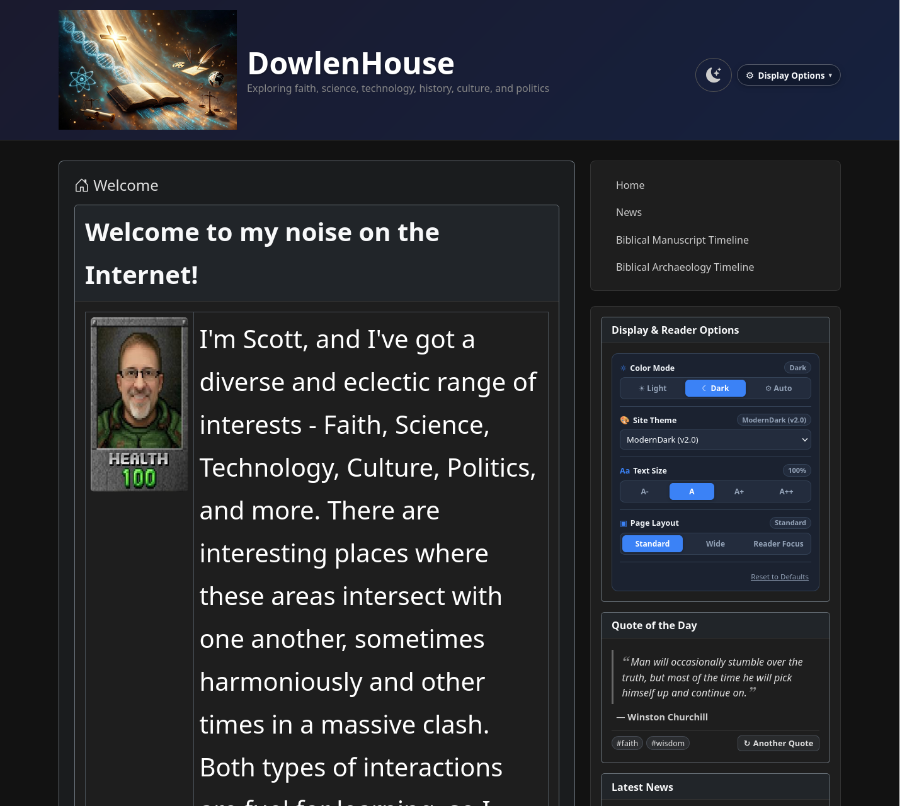
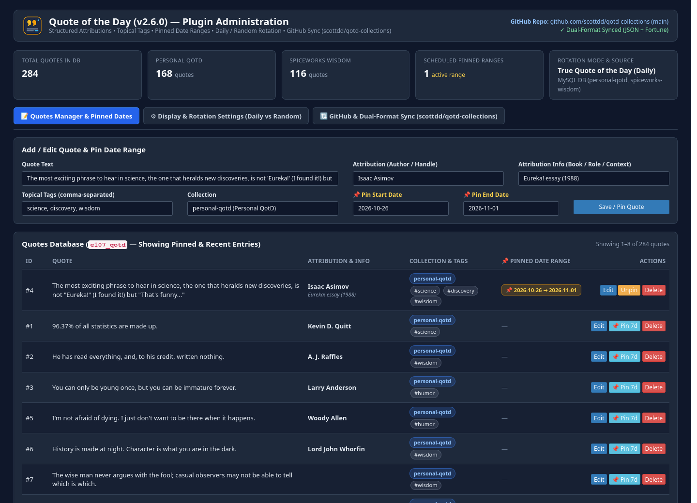

# e107 Quote of the Day (`qotd_menu`) v2.6.3

A modernized **Quote of the Day** plugin for **e107 v2.3+** (compatible with **PHP 7.4 through PHP 8.4+**) with structured attributions, topical tag pills, pinned date ranges, deterministic daily or random page-load rotation, interactive AJAX **"↻ Another Quote"** button, and one-click GitHub collection sync.

Originally inspired by the classic e107 `qotd_menu` plugin by **cameron**, completely modernized for e107 v2.3+ and PHP 8.x by **Scott Dowlen**.

> *Imagined by human, built with AI.*

---

## Key Features

- **Out-of-the-Box Clean Quote Collections (`quotes/`):**
  - **`default`** (176 quotes) — Clean, family-friendly, secular general wisdom, science, programming/technology, literature, and humor quotes enabled out of the box.
  - **`spiceworks-wisdom`** (116 quotes) — Classic IT pro, sysadmin, helpdesk, and troubleshooting humor from the Spiceworks community.
  - **Companion Repository Sync ([`scottdd/qotd-collections`](https://github.com/scottdd/qotd-collections)):** One-click sync in Admin pulls the latest `default`, `personal-qotd`, and `spiceworks-wisdom` collections in both structured JSON (`structured/*.json`) and classic BSD/Linux `fortune` (`fortune/*.fortune`) formats.
- **Non-Destructive Legacy `qotd_menu` v2.5 Upgrade & Auto-Import:**
  - **Protects `quote.txt`:** Release archives do not ship a root `quote.txt`, so extracting over a legacy `qotd_menu` v2.5 folder never overwrites your existing flat-file quotes.
  - **Automatic Database & Flat-File Migration:** On install or upgrade, any pre-existing quotes in the legacy `e107_qotd` table (`qotd_text`, `qotd_name`) and any pre-existing `qotd_menu/quote.txt` file are automatically parsed, deduplicated, and imported into the active `default` collection (tagged `#legacy`), while `quote.txt` is safely backed up to `quote.txt.legacy-bak`.
- **Structured Metadata & Theme-Inheriting Tag Pills:**
  - Stores Quote Text, Attribution (Author), Attribution Context (Book / Role / Year), Topical Tags (`#wisdom`, `#humor`, `#science`, `#technology`, `#sysadmin`), Collection, and optional Source URL.
  - Tag pills automatically inherit colors and contrast from the active e107 theme (light or dark mode).
- **Pinned Quote Date Ranges:**
  - Pin any quote to a specific `Start Date → End Date` (or click **📌 Pin 7d** in Admin) so seasonal or featured quotes automatically take priority during that window.
- **Daily or Random Rotation + Interactive AJAX Button:**
  - Choose **True Quote of the Day (Daily)** or **Random on Every Page Load**, plus an optional **↻ Another Quote** button (`qotd_ajax.php`) so visitors can browse additional quotes without reloading the page.

---

## Screenshots

### Frontend Sidebar Widget (with Attribution, Tag Pills & "↻ Another Quote" Button)


### Admin Configuration — Quotes Manager, Pinned Dates, Rotation Settings & GitHub Sync


---

## Installation

> **Important Note on Plugin Folder Name (`qotd_menu`):**
> - **Recommended:** Download **`e107-menu-qotd-v2.6.3.zip`** (or **`qotd_menu_v2.6.3.zip`**) from the [Releases page](https://github.com/scottdd/e107-menu-qotd/releases/latest). It is pre-packaged with the required **`qotd_menu/`** folder structure.
> - **If you use GitHub's green "Code → Download ZIP" button (`e107-menu-qotd-main.zip`) or `git clone`:** You **must** rename the extracted folder inside `e107_plugins/` to **`qotd_menu`** (or `e107_qotd_menu` — **never use hyphens** like `e107-menu-qotd-main`). e107 v2's `e107_handlers/shortcode_handler.php` constructs the PHP shortcode class name directly from the folder name (`<folder>_shortcodes`), and PHP class names cannot contain hyphens (`-`).

### Option A: One-Click Upload via e107 Admin (Recommended)
1. Download **`e107-menu-qotd-v2.6.3.zip`** (or **`qotd_menu_v2.6.3.zip`**) from the [latest GitHub Release](https://github.com/scottdd/e107-menu-qotd/releases/latest).
2. In your e107 Admin area, go to **Admin → Plugin Manager → Upload Plugin** and upload the `.zip` archive.
3. Install **Quote of the Day** (`qotd_menu`) and place `qotd_menu` in **Admin → Menu Manager**.

### Option B: Clone or Extract into `e107_plugins/`
```bash
cd /path/to/e107/e107_plugins
git clone https://github.com/scottdd/e107-menu-qotd.git qotd_menu
```
Then visit **Admin → Plugin Manager** to install **Quote of the Day**.

---

## Companion Quote Collections Repository

All bundled and optional quote collections are maintained in structured JSON and classic Linux `fortune` formats at:
- **[https://github.com/scottdd/qotd-collections](https://github.com/scottdd/qotd-collections)**

---

## Changelog

### v2.6.3 (2026-10-26)
- **Hyphenated Folder Resilience in `e_shortcode.php`:** Added `$classFunc = 'qotd_menu_shortcodes'` fallback in `e_parse_shortcode::loadPluginShortcodes()` scope so extracting a hyphenated folder (`e107-qotd-menu` or `e107-menu-qotd-main`) cannot trigger a fatal `TypeError` in `get_class_methods()` on PHP 8.0–8.4+.

### v2.6.2 (2026-10-26)
- **Non-Destructive Legacy `quote.txt` Protection:** Removed root `quote.txt` from the release archive so extracting over a legacy `qotd_menu` v2.5 folder never overwrites pre-existing flat-file quotes.
- **Automatic Legacy `quote.txt` & `e107_qotd` Content Import:** `ensureSchema()` now automatically imports any custom quotes from a pre-existing `quote.txt` file and/or legacy `e107_qotd` (`qotd_text`, `qotd_name`) table into the active `default` collection (tagged `#legacy`) with automatic deduplication against bundled collections, and backs up `quote.txt` to `quote.txt.legacy-bak`.

### v2.6.1 (2026-10-26)
- **Relative Path Resolution:** Replaced all hardcoded `e_PLUGIN . 'qotd_menu/...'` file includes, quote file paths, and asset/AJAX URLs with `__DIR__`-relative paths and `e107_qotd_manager::getPluginFolder()`.
- **Shortcode Handler & PHP 8.2–8.4+ Compatibility:** Added dynamic `class_alias('qotd_menu_shortcodes', '<folder>_shortcodes')` in `e_shortcode.php` so alternate valid folder names resolve cleanly on PHP 7.4 and PHP 8.x.
- **Non-English Language Fallback Hardening:** Added automatic `English_front.php` and `English_admin.php` fallback loading before `e107::includeLan()` so non-English sites never leak raw `LAN_QOTD_*` constants.

### v2.6.0 (2026-10-25)
- Complete modernization for e107 v2.3+ and PHP 8.x with structured attributions, topical tag pills, pinned date ranges, daily/random rotation, AJAX "Another Quote" button, and GitHub collection sync.

---

## Compatibility & License

- **e107 CMS:** v2.3.0+
- **PHP:** 7.4, 8.0, 8.1, 8.2, 8.3, 8.4+
- **License:** [GPL-2.0-or-later](LICENSE)

---

*Imagined by human, built with AI.*
